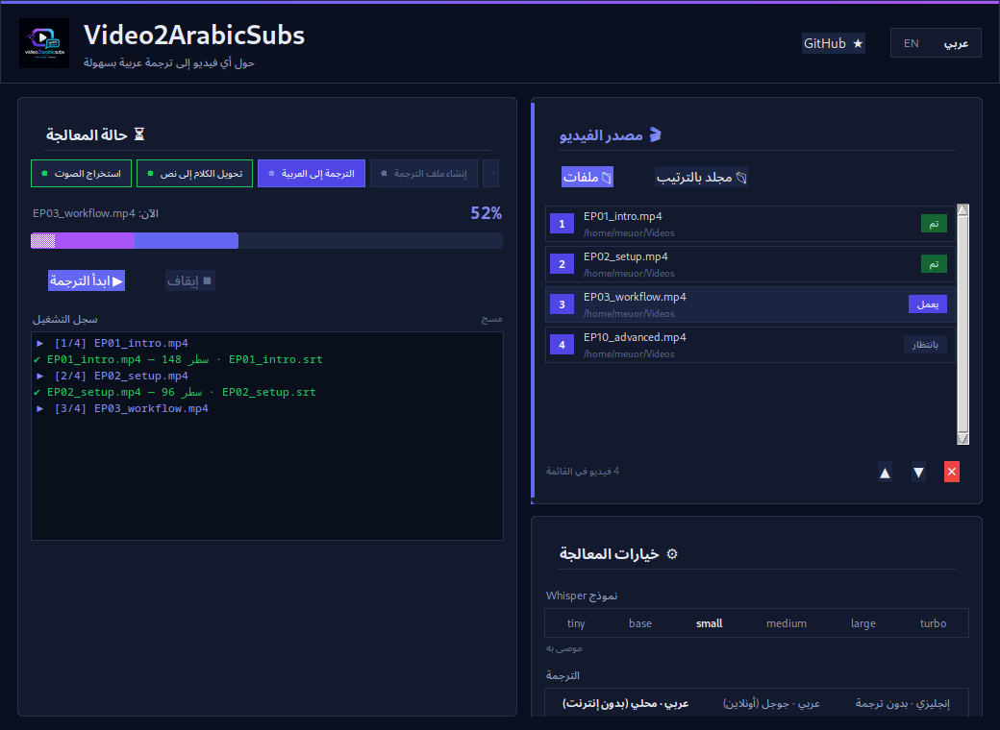
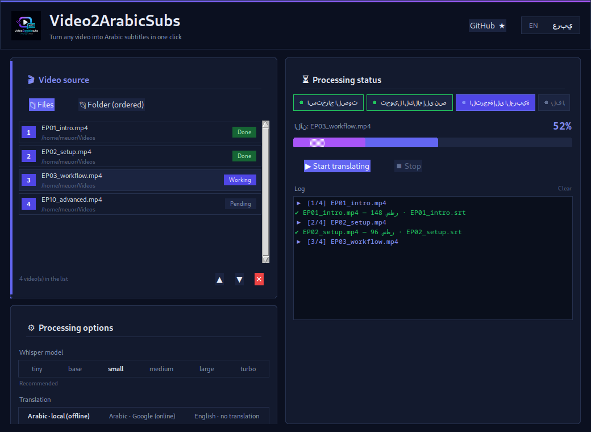
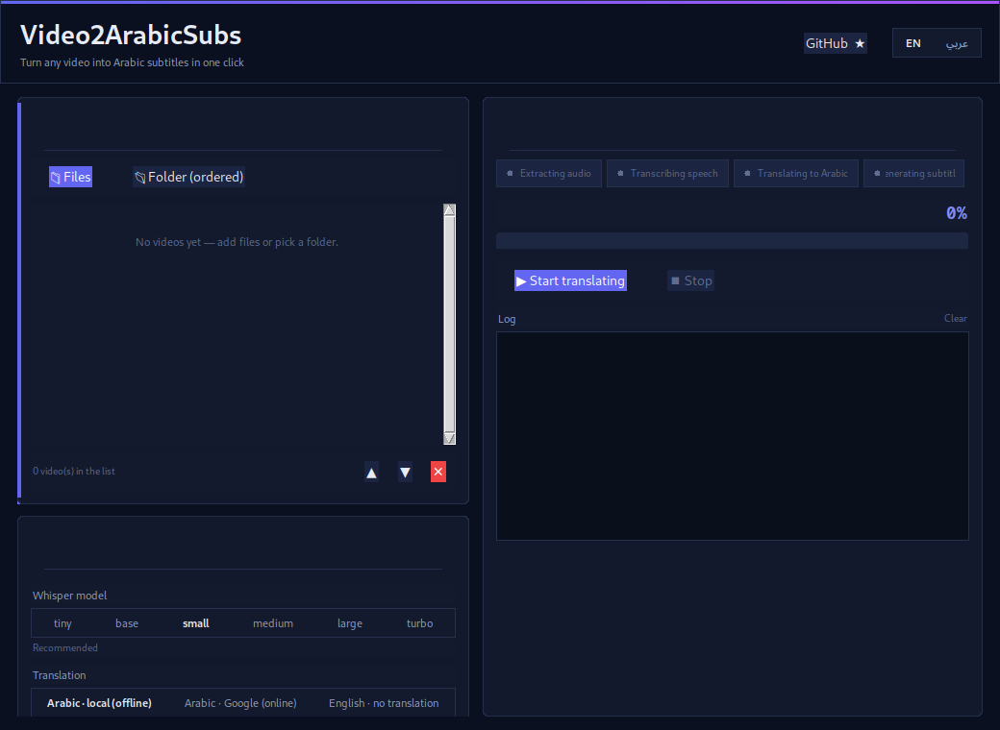
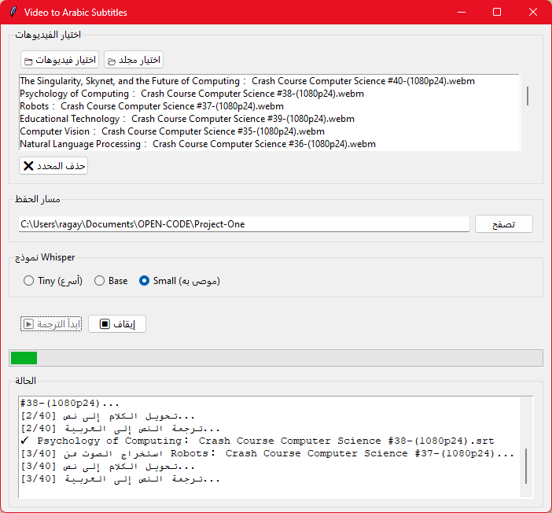

# 🎬 Video2ArabicSubs v0.4

<p align="center">
  
</p>

<p align="center">
  <strong>أي فيديو ← ترجمة عربية (SRT / VTT) بضغطة واحدة — يعمل بدون إنترنت افتراضياً</strong>
</p>

<p align="center">
  
  
  
  
  
  
  
</p>

<p align="center">
  <a href="#-التثبيت-السريع">⬇️ التثبيت السريع</a> ·
  <a href="#-لقطات-الشاشة">📸 اللقطات</a> ·
  <a href="#-المميزات">✨ المميزات</a> ·
  <a href="#-تشغيل-من-المصدر">🚀 التشغيل</a> ·
  <a href="#-بناء-الحزم">🛠️ البناء</a>
</p>

---

## 🆕 ما الجديد في الإصدار 0.4

- 🎨 **واجهة سطح مكتب عصرية بالكامل** — بطاقات دائرية الحواف، شريط تقدّم متدرّج متحرّك، شريط مراحل (stepper)، أزرار/مفاتيح بحركة ناعمة، **ثنائية اللغة عربي / English** بتبديل فوري مع انعكاس الاتجاه (RTL/LTR)، **ولا تعلّق أبداً**: كل معالجة تعمل في خيط خلفي وتتواصل عبر طابور أحداث منظّم.
- 🧠 **الترجمة المحلية أولاً (بدون إنترنت)** — المحرك الافتراضي الآن `argos` (Argos Translate)؛ جوجل موجود كخيار **صريح** فقط، مع السقوط التلقائي إليه إن رفض جوجل.
- 📁 **ملف الترجمة يُحفظ بجانب الفيديو مباشرة** — مع مجلد مخصص اختياري في الويب.
- 📂 **ترجمة مجلد كامل بالترتيب** — يمسح المجلد ويُرتّب بالترتيب الطبيعي للمسار (`ep2` قبل `ep10`، `video2` قبل `video10`) ويعالج الفيديوهات واحداً تلو الآخر، مع إعادة ترتيب ▲▼ يدوياً.
- 🎞️ **صيغة تختارها أنت**: `SRT` / `VTT` / الاثنين معاً.
- 🔥 **حرق اختياري** للترجمة داخل نسخة من الفيديو (يتطلب FFmpeg بـ libass).
- 🏷️ **سطر ترويج في النهاية**: تظهر آخر سطر ظاهر (~4 ثوانٍ، ومُحرَّق داخل الفيديو عند التفعيل) —
  `تم الترجمة بواسطة https://github.com/RaGAEIDOS/video2arabicsubs`
  مع مفتاح تشغيل/إيقاف في الواجهتين.
- 📦 **حزم تثبيت جاهزة**: `.deb` خفيفة (~1.1MB) بإعداد تلقائي عند أول تشغيل، مُثبِّت `.run` مستقل ذاتي التفكيك، مُثبِّت `.exe` لويندوز، و**مستودع apt رسمي**:
  `sudo apt install v2as`
- ✅ اختبارات جديدة: `tests/features_test.py` (37 فحصاً للمزايا الجديدة) + تحديث الاختبار الشامل.

---

## ⚡ التثبيت السريع

| المنصة | الحزمة | الأمر |
|--------|--------|-------|
| 🐧 Debian / Ubuntu (**apt**) | المستودع الرسمي | `sudo apt install v2as` ← التفاصيل أدناه |
| 🐧 Debian / Ubuntu (يدوي) | `v2as_0.4_amd64.deb` | `sudo apt install ./v2as_0.4_amd64.deb` |
| 🐧 لينكس (محمول، بدون صلاحيات) | `v2as-0.4-linux-x86_64.run` | `chmod +x *.run && ./v2as-0.4-linux-x86_64.run` |
| 🪟 ويندوز | `Video2ArabicSubs-Setup-0.4.exe` | شغّل المُثبِّت |

> كل الحزم متاحة في [**GitHub Releases**](https://github.com/RaGAEIDOS/video2arabicsubs/releases) — تُبنى تلقائياً عند كل وسم إصدار عبر GitHub Actions.

### 🐧 التثبيت الرسمي عبر apt (مستودع gh-pages)

```bash
echo "deb [trusted=yes] https://ragaeidos.website/video2arabicsubs/ stable main" \
  | sudo tee /etc/apt/sources.list.d/v2as.list

sudo apt update
sudo apt install v2as
```

ثم شغّل:

```bash
v2as                 # واجهة سطح المكتب
v2as --web           # تطبيق الويب على http://127.0.0.1:7676
v2as --lang en       # واجهة إنجليزية
v2as --setup         # إعادة تثبيت المكتبات يدوياً
```

> ℹ️ الحزمة نفسها خفيفة جداً (~1.1MB) لأنها تشحن مصادر التطبيق فقط؛ **عند أول تشغيل** يُنشئ `v2as` بيئة افتراضية خاصة بالمستخدم في `~/.cache/v2as/venv` ويُثبّت المكتبات تلقائياً (يتطلب: `python3 python3-venv python3-pip python3-tk ffmpeg` — وتُثبَّت كتبعيات من الـ apt).
>
> ℹ️ المستودع غير موقَّع، لذا يُستخدم `[trusted=yes]` (أو وقّعه بنفسك عبر متغير البيئة `APT_GPG_KEY` عند البناء). لإعداد الموقع مرة واحدة: **Settings → Pages → Source: Deploy from a branch → `gh-pages`**.

---

## 📸 لقطات الشاشة

### 🖥️ الواجهة العصرية الجديدة (v0.4)

| 🇸🇦 الوضع العربي | 🇬🇧 الوضع الإنجليزي | 🆕 جاهز للعمل |
|:-:|:-:|:-:|
|  |  |  |

### 🌐 لقطات النسخة السابقة (الويب)

<p align="center">
  
  <br/><br/>
  
</p>

---

## ✨ المميزات

**🖥️ تطبيق سطح المكتب — `v2as`**

- 🎨 واجهة عصرية مع أنيميشن خفيف (دخول البطاقات، شريط تقدّم بلمعة متحرّكة، مؤشرات متنقلة) — **بدون أي تعلّق**: لا `update()` يدور في الخلفية، التواصل عبر `queue.Queue` ورسم من مؤقّت `root.after`.
- 🌍 **ثنائية اللغة** عربي / English بتبديل فوري + RTL/LTR.
- 📂 إضافة **ملفات مفردة** أو **مجلد كامل** مع ترتيب طبيعي للمسار + إعادة ترتيب ▲▼ وإزالة.
- 🧠 محرك ترجمة: **محلي بدون إنترنت (افتراضي)** · جوجل (أونلاين) · بدون ترجمة.
- 🎞️ صيغة `SRT` / `VTT` / الاثنين — **الحفظ بجانب كل فيديو** (أو مجلد مخصص).
- 🔥 حرق اختياري داخل الفيديو + خيار BOM لتوافق مشغّلات ويندوز.
- 🏷️ سطر الترويج النهائي مع مفتاح تشغيل، وشريط مراحل (استخراج ← تحويل ← ترجمة ← ملف ← حرق).
- 📌 علبة النظام (System Tray) + زر GitHub.

**🌐 تطبيق الويب — FastAPI**

- 📤 رفع بالسحب والإفلات مع تحقق من النوع والحجم، أو استقبال روابط (عبر `yt-dlp`).
- 🧠 **المحلي هو الافتراضي**، وجوجل خيار صريح، مع **سقوط تلقائي آمن** عند `429` وعودة تلقائية.
- 📡 **تقدّم لحظي عبر SSE** (نسبة + مرحلة + سجل) + إلغاء/إعادة محاولة مع **استئناف** من آخر نقطة محفوظة.
- ✏️ **محرر ترجمة تفاعلي** + مشغل فيديو يعرض النتائج مباشرة.
- 📁 مجلد حفظ اختياري على الخادم يبقى محفوظاً بعد حذف المهمة.
- ⏱️ الاحتفاظ بالمهام وإعادة استخدام الموارد تلقائياً.

**⚙️ محرك المعالجة المشترك (`core/`)**

- خط إنتاج كامل مستقل عن الواجهات: استخراج الصوت ← Whisper ← الترجمة ← كتابة الملفات ← (حرق).
- **`core/batch.py`**: مسح مجلد + ترتيب طبيعي + تنفيذ متسلسل + أحداث لكل ملف.
- **`core/credit.py`**: سطر الترويج كآخر سطر ظاهر محاذي لنهاية الفيديو.
- ترجمة جوجل مدموجة ومقنَّنة: دفعات + حدّ سرعة + انتظار تصاعدي + استئناف + سقوط للمحرك المحلي.

---

## 🚀 تشغيل من المصدر

### المتطلبات

- **Python 3.9+**
- **FFmpeg** (يُوفَّر افتراضياً عبر `imageio-ffmpeg`، والنظام مفضَّل لحرق الترجمة)
- إنترنت **للأول تشغيل فقط** (تنزيل نموذج Whisper + نموذج اللغة المحلي) — بعدها يعمل محلياً بالكامل

```bash
git clone https://github.com/RaGAEIDOS/video2arabicsubs.git
cd video2arabicsubs
pip install -r requirements.txt
```

### 🖥️ تطبيق سطح المكتب

```bash
python main.py              # عربي (الافتراضي)
python main.py --lang en    # إنجليزي
```

1. **📁 ملفات** أو **📂 مجلد** — يُضاف للقائمة بالترتيب الطبيعي
2. **⚙️ الخيارات** — النموذج، محرك الترجمة، الصيغة، مكان الحفظ، سطر الترويج، الحرق، BOM
3. **▶ ابدأ الترجمة** — شريط المراحل والتقدّم + السجل لحظياً، و**⏹ إيقاف** متاح في أي لحظة

### 🌐 تطبيق الويب

```bash
python main.py --web                        # → http://127.0.0.1:7676
# أو مباشرة:
uvicorn web.main:app --reload               # → http://127.0.0.1:8000
```

> 🪄 أول تشغيل يُحمّل نموذج Whisper (~461MB لـ `small`)؛ وإن اخترت «محلي» يُحمّل **نموذج اللغة مرة واحدة** (~100MB) ثم تعمل الترجمة بدون إنترنت نهائياً.

**متغيرات البيئة (اختيارية):**

| المتغير | الافتراضي | الوصف |
|---------|-----------|--------|
| `V2A_MAX_UPLOAD_MB` | `2048` | الحد الأقصى لحجم الرفع |
| `V2A_JOB_TTL` | `1800` | ثوانٍ قبل حذف نتائج المهام المنتهية |
| `V2A_MAX_CONCURRENT` | `1` | المهام الثقيلة بالتوازي |
| `V2A_DATA_DIR` | `web/data` | مجلد البيانات المؤقتة |

**Docker / Hugging Face Spaces:**

```bash
docker build -t video2arabicsubs .
docker run -p 8000:76 -v v2a-data:/data video2arabicsubs
```

> المنفذ `76` هو اتفاق Hugging Face Spaces — أضف بيانات المساحة (SDK: Docker) في أول هذا الملف كما هي، واربط المستودع في [إنشاء Space](https://huggingface.co/new-space) ليُبنى تلقائياً. النموذج يُخزَّن في فولم `/data` فيبقى بعد إعادة التشغيل، والنسخة المجانية تنام بعد الخمول.

---

## 🌐 نقاط الـ API

| Method | Endpoint | الوصف |
|--------|----------|-------|
| `GET` | `/api/health` | القدرات والخيارات والافتراضيات |
| `POST` | `/api/upload` | رفع ملف + خيارات → `job_id` |
| `POST` | `/api/url` | رابط فيديو (يتطلب `yt-dlp`) |
| `GET` | `/api/status/{job_id}` | لقطة JSON من حالة المهمة |
| `GET` | `/api/events/{job_id}` | **بث SSE** للتقدم |
| `GET` | `/api/subtitles/{job_id}` | الترجمات (JSON) |
| `PUT` | `/api/subtitles/{job_id}` | حفظ تعديلات المحرر |
| `GET` | `/api/download/{job_id}` | `srt` / `vtt` / الفيديو المُحروق |
| `GET` | `/api/video/{job_id}` | بث الفيديو للمشغل (يدعم Range) |
| `POST` | `/api/cancel/{job_id}` | إيقاف مهمة |
| `POST` | `/api/job/{job_id}/retry` | إعادة محاولة مع **الاستئناف** |
| `DELETE` | `/api/job/{job_id}` | حذف المهمة وبياناتها |

> خيارات الرفع: `model_size` · `engine` (`argos`\|`google`\|`none`) · `output_format` (`srt`\|`vtt`\|`both`) · `burn_video` · `add_bom` · **`add_credit`** · `output_dir` (اختياري).

---

## 🧪 الاختبار

```bash
python tests/features_test.py   # مزايا v0.4 (الائتمان، الترتيب الطبيعي، الدفعات…) — 37 فحصاً
python tests/smoke_test.py      # اختبار شامل E2E (محاكاة كامل لخط الإنتاج + الويب + سطح المكتب)
python tests/demo_server.py     # خادم تجريبي بنتائج وهمية → http://127.0.0.1:8477
python tests/screenshot.py      # توليد لقطات الواجهة للتوثيق (يحتاج DISPLAY)
```

كلها تعمل **بدون تنزيل نماذج ML وبدون إنترنت** (تُحاكي المراحل الثقيلة).

---

## 🛠️ بناء الحزم

```bash
./scripts/build-deb.sh          # → dist/v2as_0.4_amd64.deb         (خفيفة ~1.1MB)
./scripts/build-run.sh          # → dist/v2as-0.4-linux-x86_64.run   (محمول، بدون صلاحيات)
./scripts/build-apt-repo.sh     # → build/apt-repo/   (pool + dists جاهزة لنشر gh-pages)

# ويندوز:
pip install -r requirements-build.txt
pyinstaller --clean video2arabicsubs.spec     # → dist/Video2ArabicSubs/
makensis installer.nsi                        # → dist/Video2ArabicSubs-Setup-0.4.exe
# أو build.bat الذي يفعل الثلاثة معاً
```

**سير عمل CI** (`.github/workflows/release.yml`): اختبارات ← بناء `.deb` + `.run` + مستودع apt على لينكس ← بناء `.exe` على ويندوز ← نشر شجرة المستودع إلى `gh-pages` ← إرفاق كل الحزم بـ **GitHub Release** عند دفع وسم `v*`.

> 📌 للنشر: ادفع المشروع و**فعّل Pages** (Settings → Pages → Deploy from a branch → `gh-pages`) ليصبح التثبيت `sudo apt install v2as` متاحاً رسمياً.

---

## ⚙️ التقنيات المستخدمة

| المكتبة | المهمة |
|---------|--------|
| [openai-whisper](https://github.com/openai/whisper) | تحويل الكلام إلى نص (Speech-to-Text) |
| [argostranslate](https://github.com/argosopentech/argos-translate) | **ترجمة عربية محلية (الافتراضي — بدون إنترنت)** |
| [deep-translator](https://github.com/nidhaloff/deep-translator) | ترجمة جوجل (خيار صريح + احتياطي تلقائي) |
| [moviepy](https://github.com/Zulko/moviepy) | استخراج الصوت من الفيديو |
| [imageio-ffmpeg](https://github.com/imageio/imageio-ffmpeg) | تضمين FFmpeg تلقائياً |
| [FastAPI](https://fastapi.tiangolo.com/) + [uvicorn](https://www.uvicorn.org/) | خادم الويب + SSE |
| [Tailwind CSS](https://tailwindcss.com/) | تنسيق الويب (CDN، بدون خطوة بناء) |
| Tkinter (`app/widgets.py`, `app/theme.py`) | واجهة سطح مكتب عصرية بأنيميشن خاص |
| [pystray](https://github.com/moses-palmer/pystray) + [Pillow](https://python-pillow.org/) | علبة النظام والأيقونات |
| [PyInstaller](https://pyinstaller.readthedocs.io/) + NSIS + `dpkg-deb` | بناء `.exe` و `.deb` و `.run` |

---

## 📦 هيكل المشروع

```
video2arabicsubs/
├── main.py                       # نقطة الدخول (--web / --lang / --version)
├── requirements.txt              # متطلبات التشغيل (تُثبَّت عند أول تشغيل الحزمة)
├── requirements-build.txt        # متطلبات البناء (PyInstaller)
├── Dockerfile                    # صورة الويب (تعمل على HF Spaces)
├── installer.nsi                 # مُثبِّت ويندوز NSIS
├── video2arabicsubs.spec         # إعدادات PyInstaller (onedir)
├── PLAN.md                       # خطة التحديث إلى v0.4 (مرجع التنفيذ)
├── img/first-logo-design.png     # شعار التطبيق
├── core/                         # ⭐ محرك المعالجة (مستقل عن الواجهات)
│   ├── models.py                 #    Cue / JobOptions / Stage / الأحداث
│   ├── batch.py                  #    مسح مجلد + ترتيب طبيعي + تنفيذ متسلسل
│   ├── credit.py                 #    سطر الترويج كآخر سطر ظاهر
│   ├── audio.py · transcribe.py  #    استخراج الصوت + Whisper
│   ├── translate.py              #    argos (محلي) / google / none + سقوط تلقائي
│   ├── subtitles.py              #    SRT + WebVTT (UTF-8 / BOM)
│   └── pipeline.py               #    خط الإنتاج + الحفظ بجانب الفيديو + الحرق
├── app/                          # 🖥️ سطح المكتب (Tkinter)
│   ├── gui.py                    #    الواجهة العصرية ثنائية اللغة
│   ├── widgets.py                #    بطاقات/أزرار/مفاتيح/شريط تقدّم متحرّك
│   ├── theme.py · i18n.py        #    الهوية البصرية + جدول الترجمات
│   └── processor.py              #    خيط خلفي + طابور أحداث (لا تعلّق)
├── web/                          # 🌐 الويب (FastAPI + static/)
├── packaging/                    # 📦 قوالب التغليف (المُشغّل + ملفات deb)
├── scripts/                      #    build-deb.sh · build-run.sh · build-apt-repo.sh
├── .github/workflows/release.yml #    CI: اختبار + بناء + نشر gh-pages + Release
├── tests/                        #    smoke · features · screenshot · demo_server
└── screenshots/                  #    لقطات الواجهة (جديدة + سابقة)
```

---

## 🏷️ سطر الترويج

بشكل افتراضي تُضاف نهاية كل ملف ترجمة سطر ظاهر (~4 ثوانٍ، ودخل الفيديو تلقائياً عند تفعيل الحرق):

```
تم الترجمة بواسطة https://github.com/RaGAEIDOS/video2arabicsubs
```

يمكن تعطيلها من مفتاح **«إضافة سطر الترويج في النهاية»** في الواجهة (سطح مكتب / ويب).

---

## 👨‍💻 المطور

- **Ragaei Muhammed**
- 🚀 Powered by [OpenCode](https://opencode.ai)
- 🔗 <https://github.com/RaGAEIDOS/video2arabicsubs>

---

## 📄 الترخيص

هذا المشروع مرخص تحت **MIT License** — انظر ملف [LICENSE](LICENSE) للتفاصيل.

---

<p align="center">
  <b>Made with ❤️</b>
</p>
